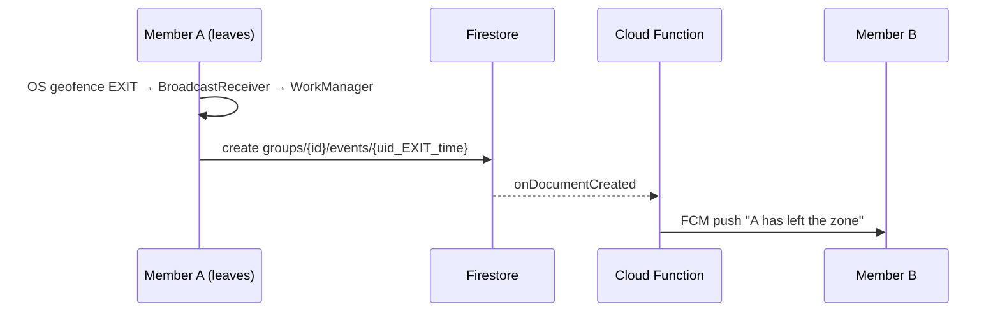

# GeoGuard: Group Geofence Alerts (Android)

**Demo video:** _add Loom link here_

A group of users creates a tracking group with a geofenced zone. When any member leaves the zone,
all **other** members get a push notification, even when the apps are closed.

**Stack:** Kotlin · Jetpack Compose · MVVM · Google Play Services Geofencing API · WorkManager ·
Firebase (Auth, Firestore, Cloud Functions, Cloud Messaging).
Android-only, as confirmed with the hiring team.

## Requirements → implementation

| Requirement | How it's done |
|---|---|
| Users can create a tracking group | Email/password login; create a group with a name and invite code; others join with the 6-character code |
| Associate a geofence with the group | Zone = your current location + radius (150–1000 m), stored on the group |
| Detect when a member moves out | Android **Geofencing API** registers one geofence per group; the OS reports EXIT even if the app is killed |
| Notify the other members | The phone writes an EXIT event to Firestore → a **Cloud Function** sends an **FCM push** to every other member |

## How it works



## Key decisions

- **Geofencing API instead of polling GPS:** battery-efficient, works in the background with no
  persistent notification. Trade-off: alerts can take ~1–2 min, and the radius must be ≥ 150 m to be reliable.
- **WorkManager for uploads:** the exit is uploaded even if the phone is offline at that moment (with retries).
- **Deterministic event IDs (`uid_EXIT_timestamp`):** retries never create duplicate alerts.
- **Server-side notifications:** no secret keys in the app, and receivers get alerts with the app closed.
- **Reliability:** geofences are re-registered after a reboot; a 5-minute cooldown stops GPS jitter
  at the zone edge from spamming alerts.
- **Security (`firestore.rules`):** only members can read a group; users can only add *themselves*
  when joining and only report *their own* exits; push tokens are private; groups can't be listed or browsed.

## Run it

1. Create a Firebase project, add an Android app `com.example.geoguard`, and put `google-services.json` in `app/`.
2. Enable Email/Password Auth and Firestore (`asia-south1`); upgrade to the Blaze plan (needed for Cloud Functions).
3. Deploy the backend:
   ```bash
   firebase use --add
   cd functions && npm install && cd ..
   firebase deploy --only firestore:rules,functions
   ```
4. Run the app on two devices (an emulator with Google Play images + a phone) and grant
   **"Allow all the time"** location and notifications.
5. To simulate leaving on the emulator: `adb emu geo fix <lng> <lat>` inside the zone, then ~1 km away.

## Tests

- Android unit tests (22): `./gradlew testDebugUnitTest`
- Cloud Function tests (28): `cd functions && npm test`

## Known limitations

- Alerts can be delayed by up to ~2 minutes (geofencing trade-off).
- Members can't leave a group yet.
- One device per account receives alerts.
- Next steps: Firebase App Check, mock-location detection, iOS via Kotlin Multiplatform.

