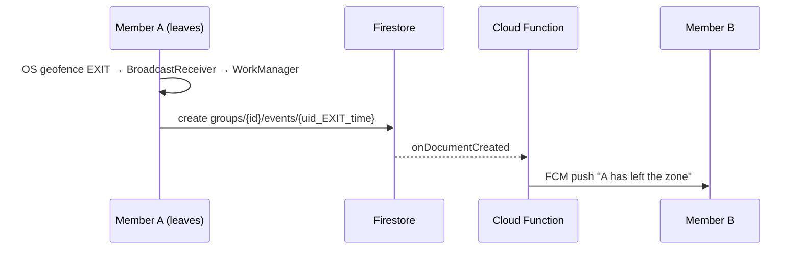

# GeoGuard: Group Geofence Alerts (Android)

**Demo video:** _add Loom link here_

A group of users creates a tracking group with a geofenced zone. When any member leaves the zone,
all **other** members get a push notification, even when the apps are closed.

**Stack:** Kotlin · Jetpack Compose · MVVM · Google Play Services Geofencing API · WorkManager ·
Firebase (Auth, Firestore, Cloud Functions, Cloud Messaging).
Android-only, as confirmed with the hiring team.

## Requirements → implementation

| Requirement | How it's done |
|---|---|
| Users can create a tracking group | Email/password login; create a group with a name and invite code; others join with the 6-character code |
| Associate a geofence with the group | Zone = your current location + radius (150–1000 m), stored on the group |
| Detect when a member moves out | Android **Geofencing API** registers one geofence per group; the OS reports EXIT even if the app is killed |
| Notify the other members | The phone writes an EXIT event to Firestore → a **Cloud Function** sends an **FCM push** to every other member |

## How it works



## Key decisions

- **Geofencing API instead of polling GPS:** battery-efficient, works in the background with no
  persistent notification. Trade-off: alerts can take ~1–2 min, and the radius must be ≥ 150 m to be reliable.
- **WorkManager for uploads:** the exit is uploaded even if the phone is offline at that moment (with retries).
- **Deterministic event IDs (`uid_EXIT_timestamp`):** retries never create duplicate alerts.
- **Server-side notifications:** no secret keys in the app, and receivers get alerts with the app closed.
- **Reliability:** geofences are re-registered after a reboot; a 5-minute cooldown stops GPS jitter
  at the zone edge from spamming alerts.
- **Security (`firestore.rules`):** only members can read a group; users can only add *themselves*
  when joining and only report *their own* exits; push tokens are private; groups can't be listed or browsed.

## Try it quickly (no setup)

Download **`app-debug.apk`** from the [latest release](https://github.com/Darshan-05032003/GeoGuard/releases)
and install it on two Android devices (or one device + an emulator with Google Play). It connects to my
Firebase project, so register two accounts, create a group on one device, join it from the other with the
invite code, and grant **"Allow all the time"** location and notifications.

## Run it yourself

**Requirements:** Android Studio (latest stable, with Android SDK 37), Node.js 22, a Google account.

1. **Firebase project:** create one in the Firebase console → add an Android app with package
   `com.example.geoguard` → download `google-services.json` into the `app/` folder.
2. In the console, enable **Authentication → Email/Password** and **Firestore** (location **asia-south1**;
   if you pick another location, change `region` in `functions/index.js` to match).
   Upgrade to the **Blaze** plan (required for Cloud Functions; demo usage stays in the free tier).
3. **Deploy the backend** from the project root:
   ```bash
   npm install -g firebase-tools
   firebase login
   firebase use --add            # select your project, alias: default
   cd functions && npm install && cd ..
   firebase deploy --only firestore:rules,functions
   ```
   On the very first deploy, Firebase may fail with an *"Eventarc Service Agent"* permission error.
   That's a one-time setup delay on Google's side: wait 3–5 minutes and run the same deploy again.
4. **Run the app:** open the project in Android Studio → let Gradle sync → Run ▶ on two devices
   (an emulator **with Google Play** + a phone works well). Use a **different account on each device**.
5. **Simulate leaving the zone on the emulator** (longitude first; the zone centre is shown on the group screen):
   ```bash
   adb -s emulator-5554 emu geo fix <lng> <lat>          # move INSIDE first, open Google Maps, wait ~1 min
   adb -s emulator-5554 emu geo fix <lng> <lat+0.01>     # then ~1 km OUTSIDE → the other device gets the push
   ```
   A geofence fires only on a *crossing*, so the device must be inside before it moves out.
   Each member triggers at most **one alert per group every 5 minutes** (cooldown against GPS jitter).
   Repeat exits within that window are still shown in the group's activity feed.
   
## Known limitations

- Alerts can be delayed by up to ~2 minutes (geofencing trade-off).
- Members can't leave a group yet.
- One device per account receives alerts.
- Next steps: Firebase App Check, mock-location detection, iOS via Kotlin Multiplatform.

