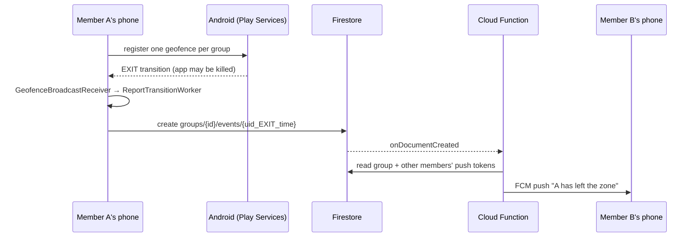

# GeoGuard: group geofence alerts for Android

A group of users creates a **tracking group** with a **geofenced safe zone**. When any member
**leaves the zone**, every **other** member gets a push notification, even if both apps are closed.

> Demo video (Loom): _add link here_

Built in **Kotlin + Jetpack Compose** with the **Google Play Services Geofencing API** and **Firebase**
(Auth, Firestore, Cloud Functions, Cloud Messaging). The brief allowed Android or iOS; this is the
Android implementation (confirmed with the hiring team).

## Features

- Email/password sign-up and login (session persists)
- Create a group: name + zone centre from current location + radius slider (150–1000 m)
- 6-character invite code (no ambiguous 0/O/1/I), shareable from the group screen
- Join with a code, without being able to list or discover other groups
- Live group screen: members with Inside / Outside status and a recent-activity feed
- **Background exit detection** with OS-managed geofences (works with the app killed)
- **Push alert to all other members** when someone leaves, e.g. "home1: test2 has left the home1 zone."
- Step-by-step permissions: precise location → "Allow all the time" → notifications
- Offline-safe event upload (WorkManager with retries); geofences restored after reboot

## Architecture



**App:** MVVM. Compose screens (stateless) → ViewModels (`StateFlow` UI state) → repositories → Firebase / Play Services.

```
app/src/main/java/com/example/geoguard/
├── data/model/        Group, SafeZone, User, ZoneEvent
├── data/repository/   Auth, Group, Event, Token, User repositories
├── data/location/     LocationRepository (one-shot precise fix)
├── geofence/          GeofenceManager, GeofenceBroadcastReceiver, ReportTransitionWorker,
│                      BootReceiver, GeofenceResyncWorker, GeofenceTransitionMapper
├── notification/      GeoGuardMessagingService (FCM), NotificationHelper
├── ui/                auth, groups, creategroup, groupdetail, permissions, navigation, theme
└── util/              InviteCodeGenerator
functions/             Cloud Function (Node 22): src/notify.js (pure logic), src/handler.js, tests
firestore.rules        Security rules
```

### Firestore data model

| Path | Contents | Who can read |
|---|---|---|
| `users/{uid}` | name, email | owner only |
| `fcmTokens/{uid}` | push token | owner only (function uses admin access) |
| `groups/{groupId}` | name, inviteCode, ownerId, memberIds[], memberNames{}, zone{lat,lng,radiusMeters} | members |
| `inviteCodes/{CODE}` | groupId | get by exact code only, never listed |
| `groups/{id}/events/{uid_TYPE_time}` | userId, userName, type (EXIT/ENTER), timestamp | members |

## Design decisions and trade-offs

| Decision | Why | Trade-off |
|---|---|---|
| **Geofencing API** instead of polling GPS in a foreground service | Evaluated on-device by the OS, battery-efficient, works when the app is killed, no permanent notification | Alerts can take ~1–2 min; radii under ~150 m are unreliable (hence the 150 m minimum) |
| **Cloud Function + FCM** for alerts | Receivers get alerts with their app closed; no secret keys in the APK | Requires the Firebase Blaze plan |
| **WorkManager** for uploads | A broadcast receiver only has ~10 s; WorkManager waits for network and retries | Uploads are delayed while offline (the alert then says "(N min ago)") |
| **Deterministic event ids** `uid_TYPE_timestamp` | A retried upload overwrites instead of duplicating, and doesn't re-trigger the function | — |
| **Invite-code lookup collection** | Joining never requires listing groups, so groups can't be enumerated | Codes are guessable by brute force at very large scale (App Check would mitigate) |
| **Push tokens in an owner-only collection** | Other members can never read your token | One token per user (last signed-in device wins) |
| **Names stored on the group** | Members don't need access to each other's user documents | Name changes don't propagate to existing groups |
| **No initial trigger** on registration | Re-registering on every app start must not spam events | A member already outside when joining isn't reported until they re-enter and leave |
| **5-minute alert cooldown per member** (server-side) | GPS jitter at the zone edge can produce repeated exits | A genuine second exit within 5 min isn't pushed (still shown in the activity feed) |
| **Single Android module** (not KMP) | The brief allowed Android only; time-boxed to 36 h | Models/repositories are plain Kotlin and could move to a KMP `shared` module for iOS |

## Security

`firestore.rules` denies everything by default, then allows:
- **users / fcmTokens:** owner only
- **groups:** readable by members only; creating requires you to be the sole member/owner, a valid zone, and the invite code written in the same batch
- **joining:** a non-member may only add **themselves** (no adding others, removing members, editing name/zone, or duplicate ids)
- **events:** members only, only about **yourself**, deterministic id, timestamp within the last 24 h, append-only

The Cloud Function also validates every event (membership, type, time window), takes display names from the group document rather than the client, and sanitises them before building the notification.

## Setup

1. Create a Firebase project and add an Android app with package `com.example.geoguard`.
   Download `google-services.json` into `app/` (it is git-ignored).
2. Enable **Authentication → Email/Password** and **Firestore** (location `asia-south1`;
   if you choose another location, change `region` in `functions/index.js` to match).
3. Upgrade to the **Blaze** plan (needed for Cloud Functions; demo usage stays in the free tier).
4. Deploy:
   ```bash
   npm install -g firebase-tools
   firebase login
   firebase use --add
   (cd functions && npm install)
   firebase deploy --only firestore:rules,functions
   ```
5. Run the app from Android Studio on a device or an emulator **with Google Play**.

## Tests

| Suite | Command | Covers |
|---|---|---|
| Android unit tests (22) | `./gradlew testDebugUnitTest` | invite codes, transition mapping, event ids, member status, create-group validation |
| Cloud Function tests (28) | `cd functions && npm test` | validation, recipients, cooldown, dead-token cleanup, name sanitisation, batching |

## Trying it with an emulator

1. Use two devices (an emulator and a phone) signed in to different accounts, both in the same group,
   with "Allow all the time" and notifications granted.
2. Note the zone centre from the group screen, then move the emulator inside the zone
   (`adb -s emulator-5554 emu geo fix <lng> <lat>`). Open Google Maps on the emulator so it requests a fix.
3. Move it about 1 km away (`adb ... geo fix <lng> <lat+0.01>`) and open Maps again.
   Within about a minute the other phone receives the alert and the group screen shows the member as **Outside**.

## Known limitations / future work
- Geofence alerts are not instant (typically under 2 minutes).
- Members can't leave a group yet, and owners can't remove members.
- One push token per user (last signed-in device).
- When many members leave at once, each phone gets one alert per member (no aggregation yet).
- Next steps: Firebase App Check, rejecting mock locations, Firestore rules emulator tests, and an iOS client via Kotlin Multiplatform.

## Tools used
I built this project step by step with guidance from Claude (an AI assistant). The early parts
(project setup, data models, login, group list, join and create screens) I typed myself while learning
each concept. Under the 36-hour deadline, the later parts (group detail, background geofencing,
notifications, Cloud Function, security rules and tests) were AI-generated with explanations, then
reviewed, integrated, deployed and tested on real devices by me.